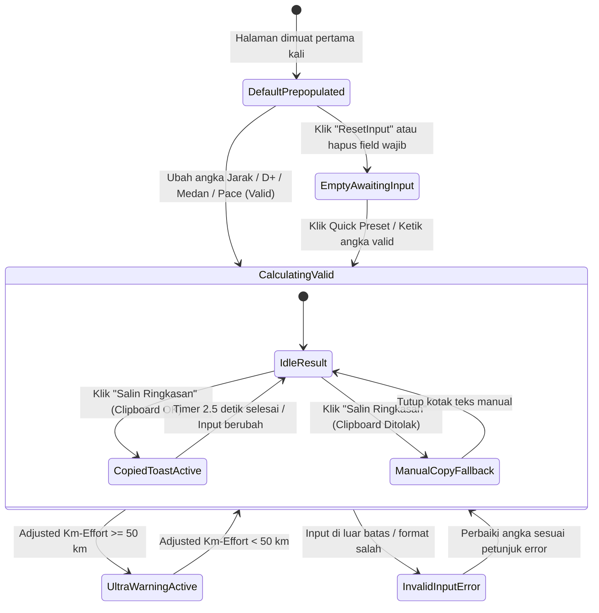

# User Flows & System States: Trail-to-Road Effort Converter

**Dokumen:** `docs/design/flows.md`  
**Tanggal:** 19 Oktober 2026  
**Penulis:** The Experience Crafter (Lead UI/UX Designer)  
**Referensi PRD:** `docs/product/prd-trail-effort-converter.md`  
**Status:** Ready for Engineering Handoff

---

## 1. End-to-End User Flow (Mermaid Flowchart)

Diagram berikut memetakan alur pengguna mulai dari pertama kali membuka halaman (*First-Time / Default State*), menggunakan *Quick Presets* atau mengetik manual (*Happy Path*), memicu validasi input (*Invalid/Error State*), memicu peringatan jarak ultra (*Extreme Ultra Warning State*), hingga menyalin hasil ke *clipboard* (*Copy Summary Feedback State*).

```mermaid
flowchart TD
    Start(["Pengguna Membuka Aplikasi Web"]) --> InitState["First-Time / Default State:
    Input terisi default contoh realistis (20 km, D+ 1.000m, Pace 06:00/km)
    atau pengguna klik 'Reset / Kosongkan'"]

    InitState --> UserAction{"Aksi Pengguna"}

    %% Quick Preset Path
    UserAction -->|"Klik Quick Preset
    (misal: Tahura 21K / Siksorogo 15K / 50K Ultra)"| PopulatePreset["Isi otomatis Jarak, D+, & Medan sesuai Preset"]
    PopulatePreset --> ValidateInput

    %% Manual Input Path
    UserAction -->|"Ketik Jarak (km) & Elevasi D+ (m)"| ValidateInput{"Validasi Input Real-Time"}
    
    %% Reset / Empty State Path
    UserAction -->|"Hapus semua angka / Klik Reset"| EmptyState["Empty State:
    Panel hasil menampilkan panduan ramah
    'Masukkan jarak & D+ atau pilih preset di atas'"]
    EmptyState --> UserAction

    %% Validation Branches
    ValidateInput -->|"Input Tidak Valid
    (Jarak <= 0, D+ < 0, > batas maks, atau karakter non-angka)"| ErrorState["Invalid Input / Error State:
    Tampilkan border merah & pesan korektif spesifik di bawah field.
    Tahan hasil terakhir atau tampilkan tanda '—'"]
    ErrorState -->|"Pengguna memperbaiki angka"| ValidateInput

    ValidateInput -->|"Input Valid
    (0.1 <= Jarak <= 500 km, 0 <= D+ <= 25.000 m)"| CalcCore["Hitung Instan (Client-Side):
    1. Base ITRA Km-Effort = Jarak + (D+ / 100)
    2. Adjusted Road Equivalent = Base * Multiplier Medan
    3. Klasifikasi Kategori ITRA (XXS s/d XXL)"]

    CalcCore --> CheckUltra{"Apakah Adjusted Effort >= 50 km
    ATAU Jarak Trail >= 42.2 km?"}

    CheckUltra -->|"Ya"| UltraWarning["Extreme Ultra Warning State:
    Tampilkan Callout Warning kuning/amber:
    'Perhatian Jarak Ultra: Di atas 50 Km-Effort, kelelahan otot
    bersifat non-linear (fatigue decay).'"]
    CheckUltra -->|"Tidak"| StandardResult["Standard Result State:
    Sembunyikan banner peringatan ultra"]

    UltraWarning --> CheckPace{"Apakah Flat Road Pace diisi?"}
    StandardResult --> CheckPace

    CheckPace -->|"Kosong / Belum Diisi"| PaceEmptyState["Optional Pace Empty State:
    Tampilkan hasil Km-Effort utama.
    Kartu Waktu menampilkan prompt:
    'Isi Flat Road Pace Anda untuk melihat estimasi waktu & pace trail'"]

    CheckPace -->|"Diisi namun tidak valid
    (Detik >= 60 atau Pace < 02:30 / > 20:00)"| PaceErrorState["Pace Error State:
    Pesan error inline pada input Pace:
    'Masukkan detik antara 00–59 (rentang pace 02:30–20:00/km)'"]

    CheckPace -->|"Diisi & Valid (misal 06:00/km)"| CalcTime["Full Happy Path Result:
    Hitung & tampilkan:
    - Estimasi Waktu Tempuh (Jam:Menit)
    - Effective Trail Pace (mm:ss/km)
    - Selisih perlambatan vs Road Pace"]

    PaceEmptyState --> ShareDecision{"Klik 'Salin Ringkasan'?"}
    CalcTime --> ShareDecision

    ShareDecision -->|"Ya"| CheckClipboard{"Cek Izin Clipboard Browser
    (navigator.clipboard)"}

    CheckClipboard -->|"Berhasil"| CopySuccess["Copy Summary Feedback State (Success):
    Tombol berubah hijau selama 2.5 detik:
    '✓ Ringkasan Tersalin ke Clipboard!'"]
    CheckClipboard -->|"Gagal / Tidak Punya Izin (Permission Denied)"| CopyFallback["Permission Fallback State:
    Gunakan fallback textarea selection ATAU tampilkan modal/kotak teks
    yang sudah terblok otomatis dengan pesan:
    'Izin clipboard dibatasi browser. Tekan Ctrl+C / Salin manual.'"]
```

---

## 2. State Machine Komponen Kalkulator & Copy Action

---

## 3. Matriks Spesifikasi Seluruh State (Edge Cases & System States)

Untuk memastikan tidak ada *dead-end* bagi pengguna maupun kebingungan saat implementasi *engineering*, berikut adalah definisi lengkap seluruh *state* aplikasi:

| State | Kondisi Pemicu (Trigger) | Perilaku UI & Visual | Microcopy & Tindakan Pemulihan |
| :--- | :--- | :--- | :--- |
| **1. First-Time / Default State** | Pengguna pertama kali membuka URL aplikasi. | Input pre-populated dengan nilai acuan yang langsung memahamkan cara kerja alat (`Jarak = 20 km`, `D+ = 1000 m`, `Medan = Runable 0%`, `Road Pace = 06:00 /km`) dan *Preset* siap diklik di bagian atas. | Sub-label di atas hasil: *"Menampilkan perhitungan langsung. Ubah angka di kiri atau pilih preset rute di atas."* |
| **2. Empty State (Kosong)** | Pengguna menghapus nilai `Jarak` atau menekan tombol `Reset`. | Angka *Hero Metric* menampilkan `— km`, warna teks meredup (`text-stone-400`), tombol **Salin Ringkasan** menjadi `disabled`. | *"Masukkan jarak rute (km) dan total tanjakan D+ (m), atau pilih salah satu Preset Lomba di atas untuk melihat konversi beban lari."* |
| **3. Happy Path (Valid & Reaktif)** | `0.1 <= Jarak <= 500`, `0 <= D+ <= 25000`, dan `Pace` valid (atau dikosongkan). | Kalkulasi berjalan instan (`< 16ms`, tanpa *spinner* yang menghalangi). Menampilkan **Adjusted Road Equivalent**, **Base ITRA Km-Effort**, **ITRA Badge**, **Road Benchmark**, dan **Estimasi Waktu**. | Semua angka menggunakan `font-variant-numeric: tabular-nums` agar layout tidak bergeser (*layout shift*) saat mengetik. |
| **4. Invalid Input / Error State** | - `Jarak <= 0` atau `> 500 km` - `D+ < 0` atau `> 25.000 m` - `Pace detik >= 60` atau pace di luar `02:30–20:00 /km` | Field yang bermasalah diberi *border* merah (`#DC2626`), ikon peringatan di dalam input, dan pesan *error* muncul tepat di bawah field (`aria-live="polite"`). Hasil kalkulasi ditahan pada state kosong/invalid. | - **Jarak:** *"Masukkan jarak trail antara 0,1 km hingga 500 km."* - **Elevasi:** *"Elevasi D+ tidak boleh negatif (masukkan 0 hingga 25.000 m)."* - **Pace:** *"Detik harus antara 00–59 dan pace di rentang realistis 02:30 hingga 20:00 /km."* |
| **5. Extreme Ultra Distance Warning State** | `Adjusted Road Equivalent >= 50.0 km` ATAU `Jarak Trail >= 42.2 km`. | Muncul *Callout Banner* berwarna Amber (`bg-amber-50 border-amber-300 text-amber-900`) di dalam panel hasil tepat di bawah estimasi waktu. | **Catatan Jarak Ultra (>50 Km-Effort):** *"Pada jarak ultra, kelelahan otot bersifat non-linear (fatigue decay) ditambah waktu jeda di Water Station. Siapkan cadangan waktu ekstra 15%–25% dari estimasi linear di atas."* |
| **6. Copy Summary Feedback State** | Pengguna menekan tombol **Salin Ringkasan (WA / Strava)**. | Tombol berubah warna dari *Trail Forest Green* menjadi *Success Emerald*, teks berubah disertai ikon centang selama `2.500 ms` sebelum kembali ke state normal. | Default: **"Salin Ringkasan ke WhatsApp / Strava"** Active Feedback: **"✓ Tersalin! Siap ditempel ke grup lari"** |
| **7. Tidak Punya Izin (Clipboard Permission Denied)** | Browser memblokir `navigator.clipboard.writeText` (misal: WebView in-app browser tertentu atau konteks non-HTTPS). | Aplikasi mengeksekusi *fallback* `document.execCommand('copy')`. Jika masih gagal, muncul kotak teks *read-only* yang langsung ter-블ok (*auto-selected*) di bawah tombol. | *"Browser Anda membatasi akses clipboard otomatis. Teks di bawah sudah terpilih—tekan Salin / Ctrl+C secara manual."* |
| **8. Loading & Offline State** | Koneksi internet terputus setelah halaman dimuat, atau saat halaman pertama kali dibuka. | Karena seluruh logika berjalan 100% *client-side* di browser, kalkulator **tetap berfungsi penuh saat offline** tanpa *loading spinner*. Jika koneksi terputus, tidak ada gangguan pada perhitungan. | Tidak ada *blocking loader* saat menghitung. Kalkulasi wajib terasa instan (`0ms` *perceived latency*). |
| **9. Aksi Reset (Pencegahan Kehilangan Input)** | Pengguna menekan tombol sekunder **"Reset"** untuk mengosongkan/mengembalikan ke nilai awal. | Karena tidak ada data permanen yang dihapus dari database, tombol **"Reset ke Default"** langsung mengembalikan ke nilai standar tanpa *modal* yang mengganggu, namun menyertakan perubahan halus dan kemudahan klik ulang *Quick Preset*. | Label tombol jelas: **"Reset"** (di samping header Panel Input). |
