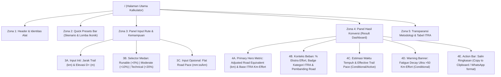
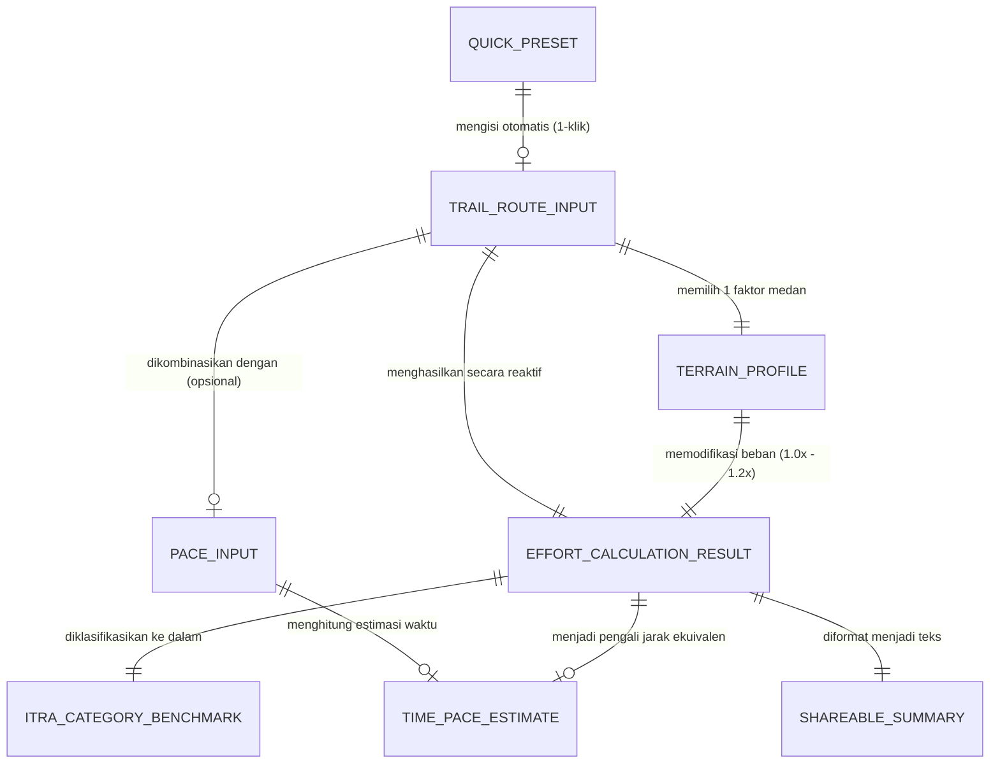

# Information Architecture (IA): Trail-to-Road Effort Converter

**Dokumen:** `docs/design/ia.md`  
**Tanggal:** 19 Oktober 2026  
**Penulis:** The Experience Crafter (Lead UI/UX Designer)  
**Referensi PRD:** `docs/product/prd-trail-effort-converter.md`  
**Status:** Ready for Engineering Handoff

---

## 1. Prinsip Arsitektur Informasi

1. **Zero-Friction Utility (Langsung ke Inti):** Tidak ada *landing page* pemasaran yang menghalangi, tidak ada *onboarding modal*, dan tidak ada login. Saat URL dibuka, pengguna langsung berhadapan dengan kalkulator yang siap dipakai.
2. **Instant Pre-populated Value (Anti Blank-Canvas Paralysis):** Layar awal memuat skenario realistis secara *default* (atau siap diklik melalui *Quick Presets*) sehingga pengguna langsung memahami hubungan antara input *Trail* dan output *Road Equivalent* dalam 2 detik pertama.
3. **Progressive Disclosure (Sederhana di Depan, Kaya di Dalam):**
   - **Lapis 1 (Wajib):** Jarak Trail (`km`) & Elevation Gain `D+` (`m`).
   - **Lapis 2 (Kontekstual/Pengaya):** Karakteristik Medan (*Terrain Technicality*) & *Flat Road Pace* (`mm:ss /km`).
   - **Lapis 3 (Edukasi & Transparansi):** Penjelasan rumus ITRA Km-Effort & pengali permukaan di bagian bawah halaman.

---

## 2. Sitemap & Struktur Halaman

Karena produk MVP adalah *Single-Page Web Utility*, struktur navigasi bersifat vertikal (*single-screen workspace* di desktop dengan *2-column split*, dan *stacked flow* di mobile):

---

## 3. Struktur Navigasi & Strategi Layout Responsif

- **Navigasi Global:** Minimalis. Hanya berisi *Brand/App Title* ("TrailEffort.id — Konverter Beban Lari Trail ke Road"), *Badge Standar* ("Berbasis ITRA Km-Effort"), dan tautan jangkar (*anchor link*) `"Cara Hitung & Rumus"` yang menggulir lembut ke Zona 5.
- **Perilaku Mobile (`< 768px` - Prioritas Utama):**
  - *Single column vertical stack*.
  - *Quick Presets* dapat digeser secara horizontal (*horizontal pill scroll*) atau *wrapped chips* yang ringkas agar tidak mendorong input terlalu jauh ke bawah.
  - Begitu input Jarak & D+ diisi, ringkasan hasil langsung terlihat tanpa perlu menekan tombol "Hitung" (*reactive calculation*).
- **Perilaku Desktop (`>= 768px`):**
  - *Two-column asymmetric grid* (12 kolom: 5 kolom kiri untuk Input & Presets, 7 kolom kanan *sticky* untuk Result Dashboard).
  - Memungkinkan pengguna mengutak-atik angka di kiri dan melihat perubahan metrik secara *real-time* di kanan pada *viewport* yang sama.

---

## 4. Hierarki Konten & Prioritas Informasi

| Prioritas | Elemen Konten | Pertanyaan Pengguna yang Dijawab | Perlakuan Visual |
| :--- | :--- | :--- | :--- |
| **P1 (Tertinggi)** | **Adjusted Road Equivalent (`km`)** & **Input Jarak + Elevasi (`D+`)** | *"Lari trail X km + D+ Y meter ini setara lari road berapa km?"* | Angka output berukuran paling besar (`display-lg`, *tabular-nums*), kontras tinggi di dalam kartu *Hero Result*. Input Jarak & D+ ditempatkan berdampingan di baris paling atas. |
| **P2 (Tinggi)** | **Estimasi Waktu Tempuh (`j:mm`)**, **Effective Trail Pace (`/km`)**, & **Terrain Selector** | *"Dengan pace road saya, berapa lama saya akan berada di jalur dan berapa pace rata-rata saya nanti?"* | Kartu metrik sekunder yang menonjol di bawah Hero Metric; *segmented radio cards* dengan penjelasan singkat untuk pilihan medan. |
| **P3 (Sedang)** | **Base ITRA Km-Effort**, **% Ekstra Beban**, **ITRA Category Badge**, & **Road Benchmark** | *"Seberapa jauh bedanya dengan rumus murni ITRA? Ini masuk kategori lomba apa?"* | *Badge* berlabel jelas (misal: `ITRA XS`, `+50% ekstra beban dari elevasi`, `~1.4x Half Marathon Road`). |
| **P4 (Pendukung)** | **Quick Presets**, **Tombol Salin Ringkasan**, **Disclaimer Ultra (>50 Km-Effort)**, & **Penjelasan Rumus** | *"Bisa coba contoh cepat? Bagaimana cara bagi ke grup WA? Dari mana angka ini berasal?"* | *Pills* interaktif di bagian atas, tombol CTA *full-width* di akhir kartu hasil, dan *accordion*/kartu edukasi di bagian bawah halaman. |

---

## 5. Objek Utama (Domain Objects) & Relasinya

### Diagram Relasi Objek

### Spesifikasi Objek & Atribut

#### 1. `QuickPreset` (Skenario & Lomba Ikonik)
Preset dikurasi untuk menjembatani skenario latihan umum dan lomba *trail* ikonik di Indonesia agar relevan bagi pelari lokal maupun umum:

| ID Preset | Label Tampilan | Jarak (`km`) | Elevasi `D+` (`m`) | Medan Default | Konteks / Catatan |
| :--- | :--- | :--- | :--- | :--- | :--- |
| `preset-10k` | **10K Short Trail** *(D+ 400m)* | `10` | `400` | `moderate` (+10%) | Rute perbukitan ramah pemula / latihan akhir pekan |
| `preset-tahura` | **Tahura / 21K Half Trail** *(D+ 1.000m)* | `21` | `1000` | `moderate` (+10%) | Karakteristik *rolling hills* & hutan pinus klasik |
| `preset-siksorogo` | **Siksorogo / 15K Steep** *(D+ 1.200m)* | `15` | `1200` | `technical` (+20%) | Tanjakan curam & teknis khas gunung tropis Indonesia |
| `preset-ultra50k` | **50K Ultra Mountain** *(D+ 3.000m)* | `50` | `3000` | `technical` (+20%) | Skenario *ultra trail* (memicu *Ultra Fatigue Warning*) |

#### 2. `TrailRouteInput` (Input Rute Utama)
- `distanceKm`: `number` (Rentang valid: `0.1` s/d `500.0` km, presisi 1 desimal).
- `elevationGainM`: `number` (Rentang valid: `0` s/d `25000` m, bilangan bulat).

#### 3. `TerrainProfile` (Faktor Teknis Permukaan)
- `id`: `'runable' | 'moderate' | 'technical'`
- `label`:
  - `'runable'`: **Runable / Fire Road** (`+0%` • Tanah padat, jalur lebar, mudahinjak)
  - `'moderate'`: **Moderate Singletrack** (`+10%` • Akar pohon, bebatuan ringan, jalur setapak)
  - `'technical'`: **Technical / Rocky / Muddy** (`+20%` • Batu lepas, lumpur licin, *scrambling* curam)
- `multiplier`: `1.00 | 1.10 | 1.20`

#### 4. `PaceInput` (Input Pace Jalan Raya — Opsional)
- `minutesPerKm`: `number` (Rentang valid: `2` s/d `20` menit)
- `secondsPerKm`: `number` (Rentang valid: `0` s/d `59` detik)
- Total pace dalam detik/km harus berada di rentang realistis: `150` detik (`02:30/km`) hingga `1200` detik (`20:00/km`). Jika dikosongkan (`null`), modul estimasi waktu menampilkan *prompt state* yang ramah.

#### 5. `EffortCalculationResult` (Output Konversi Beban)
- `elevationEffortKm`: `elevationGainM / 100`
- `baseItraKmEffort`: `distanceKm + elevationEffortKm`
- `terrainPenaltyKm`: `baseItraKmEffort * (multiplier - 1)`
- `adjustedRoadEquivalentKm`: `baseItraKmEffort * multiplier`
- `extraEffortPercentage`: `((adjustedRoadEquivalentKm - distanceKm) / distanceKm) * 100`
- `isUltraWarningActive`: `boolean` (`true` jika `adjustedRoadEquivalentKm >= 50` atau `distanceKm >= 42.2`)

#### 6. `ITRACategoryBenchmark` (Klasifikasi & Pembanding Kontekstual)
Klasifikasi mengacu pada **Base ITRA Km-Effort** sesuai spesifikasi PRD (US-1), sementara **Road Benchmark** mengacu pada **Adjusted Road Equivalent** agar relevan dengan beban otot pelari:
- `< 20 Km-Effort`: **ITRA XXS (0–19 Km-Effort • Short Trail)**
- `20 – 34 Km-Effort`: **ITRA XS (20–34 Km-Effort)**
- `35 – 64 Km-Effort`: **ITRA S (35–64 Km-Effort)**
- `65 – 99 Km-Effort`: **ITRA M (65–99 Km-Effort)**
- `100 – 139 Km-Effort`: **ITRA L (100–139 Km-Effort)**
- `140 – 189 Km-Effort`: **ITRA XL (140–189 Km-Effort)**
- `>= 190 Km-Effort`: **ITRA XXL (≥190 Km-Effort)**
- **Road Distance Benchmark:** Pembanding dinamis terhadap jarak lomba jalan raya populer:
  - `< 12 km`: Setara `~X.Xx lari 10K di jalan raya`
  - `12 – 32 km`: Setara `~X.Xx Half Marathon (21.1K) di jalan raya`
  - `> 32 km`: Setara `~X.Xx Full Marathon (42.2K) di jalan raya`

#### 7. `TimePaceEstimate` (Output Waktu & Pace Trail)
- `estimatedTotalMinutes`: `adjustedRoadEquivalentKm * flatRoadPaceInMinutes`
- `formattedDuration`: Format `X jam YY menit` (atau `YY menit` jika `< 60` menit)
- `effectiveTrailPaceSecondsPerKm`: `(estimatedTotalMinutes * 60) / distanceKm`
- `formattedEffectiveTrailPace`: Format `mm:ss /km`
- `paceSlowdownDelta`: Selisih antara `effectiveTrailPace` dan `flatRoadPace` (misal: `+03:00/km lebih lambat dari pace road`)
