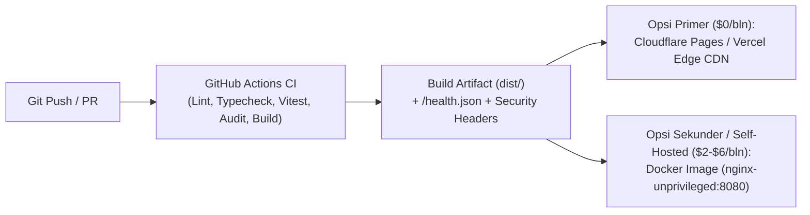

# Strategi Deployment & Analisis Biaya Infrastruktur (MVP Trail-to-Road Effort Converter)

**Dokumen:** `docs/infra/deployment.md`  
**Tanggal:** 19 Oktober 2026  
**Penulis:** The Scaler (`devops-specialist`)  
**Status:** Approved for Production  
**Referensi:**
- ADR: `docs/architecture/adr-001-tech-stack.md`
- Laporan Audit QA & Keamanan: `docs/qa/review-2026-10-19-mvp.md` (`LOW-02`: HTTP Security Headers & CSP)

---

## 1. Profil Beban Kerja (Workload Profile)

Berdasarkan `ADR-001` dan laporan audit QA, **Trail-to-Road Effort Converter** memiliki karakteristik infrastruktur yang sangat efisien:
- **Tipe Artefak:** 100% Static Single-Page Application (SPA) yang dikompilasi oleh Vite (`dist/`).
- **Ukuran Bundle Produksi:** ~225 KB *uncompressed* (~64.5 KB *gzipped* termasuk HTML, CSS Tailwind v4, dan JS React 18).
- **Kebutuhan Komputasi Server:** **Nol (0) Server-Side Compute** untuk kalkulasi. Seluruh rumus *ITRA Km-Effort*, *Terrain Modifier*, dan *Pace Estimator* dieksekusi di browser klien (`< 16ms`).
- **Database / State Backend:** Tidak ada (Zero Backend State pada tahap MVP).
- **Endpoint Observabilitas:** `GET /health.json` (statis, `200 OK`, payload JSON 82 bytes).

Dengan ukuran total aset ~65 KB *gzipped* per kunjungan pertama (dan ~0 KB pada kunjungan berikutnya berkat `Cache-Control: immutable` pada `/assets/*`), **100.000 pengunjung unik/bulan** hanya memakan sekitar **~6,5 GB bandwidth/bulan**.

---

## 2. Perbandingan Opsi Deployment & Verifikasi Harga Terkini (2025/2026)

Berikut adalah perbandingan komprehensif antara **Static Edge CDN** dan **Container Runtime (Docker)** berdasarkan verifikasi harga pasar terkini:

| Opsi Platform | Tier & Estimasi Biaya Bulanan (MVP -> 100k UV/bln) | Kebijakan Penggunaan Komersial (Free Tier) | Kompleksitas Operasional | Risiko Vendor Lock-In | Jalur Scaling (V2/V3 Backend/GPX) |
| :--- | :--- | :--- | :--- | :--- | :--- |
| **1. Cloudflare Pages** *(Rekomendasi Utama - Edge)* | **$0 / bulan** (Free Tier: *Unmetered static HTTP bandwidth*, maks 20.000 file, 500 builds/bln). Jika butuh Workers Paid: **$5 / bulan**. | **Diizinkan** (Bebas untuk proyek komersial selama mematuhi *fair use* aset web standar). | **Sangat Rendah** (Git-push auto-deploy, preview per PR, SSL/TLS otomatis, DDoS protection bawaan). | **Sangat Rendah** (Artefak standar `dist/` + `public/_headers`; pindah platform cukup dalam < 15 menit). | Integrasi langsung ke Cloudflare Workers / D1 / R2 jika V2 membutuhkan penyimpanan rute atau API Strava. |
| **2. Vercel** *(Alternatif Edge)* | **$0 / bulan** (Hobby — *Non-komersial*, 100 GB Fast Data Transfer, hard stop). **$20 / user / bulan** (Pro — 1 TB bandwidth, overage ~$0.15/GB). | **Dilarang di Hobby Tier** (Wajib upgrade ke Pro $20/bln jika digunakan untuk bisnis/monetisasi). | **Sangat Rendah** (Zero-config untuk Vite, preview URL instan, konfigurasi lewat `vercel.json`). | **Rendah** (Untuk SPA statis murni sangat mudah dipindah; lock-in hanya terjadi jika memakai fitur spesifik Next.js). | Serverless Functions & Vercel Blob/Postgres tersedia, namun biaya scaling per-seat & bandwidth relatif mahal. |
| **3. Netlify** *(Alternatif Edge)* | **$0 / bulan** (Free — sistem 300 kredit/bln $\approx$ ~15 GB bandwidth, hard cutoff). **$9 / bulan** (Personal — 1.000 kredit $\approx$ ~50 GB). **$20 / bulan** (Pro — 3.000 kredit $\approx$ ~150 GB). | **Diizinkan**, namun kuota Free (300 kredit / ~15 GB) cepat habis dan situs otomatis di-*pause* saat kredit habis. | **Sangat Rendah** (Mendukung format file `public/_headers` dan `_redirects` yang sama dengan Cloudflare Pages). | **Sangat Rendah** (Standar JAMstack murni). | Netlify Functions & Edge Functions tersedia, tetapi sistem kredit terpadu membuat prediksi biaya saat trafik melonjak lebih sulit. |
| **4. Container PaaS (Railway / Fly.io)** *(Opsi Docker Managed)* | **Railway Hobby:** **$5 / bulan** (termasuk kredit usage $5; container Nginx ~20MB RAM hanya memakan ~$1-$2/bln). **Fly.io Pay-As-You-Go:** **~$2 – $4 / bulan** (1x `shared-cpu-1x` 256MB RAM + egress $0.02/GB). | **Berbayar sejak awal** (Sistem *usage-based* dengan tagihan bulanan). | **Rendah–Sedang** (Deploy langsung dari `Dockerfile` di repositori, healthcheck `/health.json` otomatis). | **Nol (0% Lock-In)** (Menggunakan standar OCI Docker image `nginx-unprivileged` yang portabel ke mana saja). | Sangat fleksibel jika V2 membutuhkan layanan backend long-running (Node.js/Go) atau worker pemroses GPX berat. |
| **5. Hetzner VPS (CX23) + Coolify** *(Opsi Self-Hosted Container)* | **€5.49 – €7.13 / bulan** (~$6–$8/bln untuk 2 vCPU, 4 GB RAM, 40 GB NVMe, 20 TB traffic) + **Coolify Open-Source ($0)**. | **Bebas sepenuhnya** (Infrastruktur milik sendiri). | **Sedang–Tinggi** (Wajib mengelola update OS Linux, firewall UFW, backup, dan monitoring disk space). | **Nol (0% Lock-In)** (Standar Docker Compose & Linux VPS standar). | Kapasitas 4 GB RAM mampu menampung puluhan mikroservis, database PostgreSQL, dan analytics self-hosted (Umami/Plausible) tanpa tambahan biaya. |

---

## 3. Rekomendasi Arsitektur Deployment (Dual-Ready Strategy)

Untuk memaksimalkan efisiensi biaya (**$0/bulan pada fase validasi MVP**) sekaligus menjamin **0% vendor lock-in** dan kesiapan enterprise, kami menerapkan **Strategi Dual-Ready (Static Edge + Production Container)**:

### 3.1 Rekomendasi Utama (Fase Validasi 14 Hari Pertama): Cloudflare Pages
- **Biaya Bulanan:** **$0 / bulan** (dan maksimal **$5/bulan** jika kelak mengaktifkan Workers Paid).
- **Alasan Pemilihan:**
  1. **Bandwidth Statis Tak Terbatas (Unmetered):** Jika kalkulator ini viral di komunitas lari trail (WhatsApp grup pelari, Strava club, forum Tahura/Siksorogo/Rinjani), lonjakan trafik tidak akan memicu *hard pause* (seperti batas 15 GB Netlify Free) atau tagihan *overage* mengejutkan.
  2. **Ramah Komersial:** Berbeda dengan Vercel Hobby yang melarang penggunaan komersial di Terms of Service, Cloudflare Pages mengizinkan proyek startup/komersial sejak hari pertama.
  3. **Performa Jaringan Seluler Indonesia:** Edge PoP Cloudflare di Jakarta, Singapura, dan global memastikan waktu muat awal (*First Contentful Paint*) `< 0.5 detik` bahkan pada jaringan seluler di kaki gunung/trailhead.
- **Estimasi Effort Setup:** **15 Menit** (Hubungkan repositori GitHub $\rightarrow$ Build command: `npm run build` $\rightarrow$ Output directory: `dist`). File `public/_headers` yang sudah kami sediakan di repositori akan otomatis menerapkan HTTP Security Headers (`CSP`, `X-Frame-Options`, `X-Content-Type-Options`) dan *immutable caching*.

### 3.2 Rekomendasi Cadangan / Containerized: Docker (`nginx-unprivileged`) di Fly.io / Railway / VPS Coolify
- **Biaya Bulanan:** **$2 – $6 / bulan**.
- **Alasan Kesiapan:** Kami telah menyediakan `Dockerfile` multi-stage (`node:22-alpine` $\rightarrow$ `nginxinc/nginx-unprivileged:1.27-alpine`), `nginx.conf`, dan `docker-compose.yml`. Jika tim ingin menjalankan aplikasi di infrastruktur container internal atau VPS sendiri, image produksi hanya berukuran **~45 MB** dan mengonsumsi **< 20 MB RAM** dengan non-root user (`UID 101`) di port `8080`.

---

## 4. Analisis Risiko, Mitigasi & Cara Rollback

| Risiko | Dampak | Mitigasi Teknis yang Diterapkan | Prosedur Rollback (< 2 Menit) |
| :--- | :--- | :--- | :--- |
| **Regresi Rumus Kalkulasi atau UI Rusak di Produksi** | Pengguna mendapatkan angka *Km-Effort* yang salah. | Pipeline `.github/workflows/ci.yml` memblokir *merge/deploy* jika salah satu dari 27 unit/integration test (`vitest`), `tsc --noEmit`, atau `eslint` gagal. | **Edge (CF Pages/Vercel):** Klik tombol *"Rollback to previous deployment"* di dashboard (instan `< 10 detik`). **Docker:** Deploy ulang tag image commit sebelumnya (`docker compose up -d`). |
| **Kerentanan Keamanan di Browser (XSS / Clickjacking)** | Penyalahgunaan iframe atau injeksi skrip. | Konfigurasi identik diterapkan di `nginx.conf`, `public/_headers`, dan `vercel.json`: `X-Frame-Options: DENY`, `X-Content-Type-Options: nosniff`, dan `Content-Security-Policy` ketat yang hanya mengizinkan `'self'` dan Google Fonts. | Jika kebijakan CSP terlalu ketat untuk fitur baru, sesuaikan directive di `nginx.conf` / `public/_headers` dan lakukan *redeploy*. |
| **Kegagalan Memuat Font Eksternal di Sinyal Lemah** | Tampilan sedikit berubah saat *offline* di gunung. | Font di `index.html` menggunakan `display=swap` dan Tailwind memiliki fallback font sistem (`sans-serif`, `monospace`). Kalkulasi tetap berjalan 100% tanpa internet setelah halaman termuat. | Tidak memerlukan rollback; mekanisme graceful degradation berjalan otomatis di sisi browser. |

---

## 5. Exit Strategy (Strategi Migrasi Tanpa Lock-In)

Karena arsitektur mematuhi prinsip *Static Build Separation* (`ADR-001`):
1. **Dari Cloudflare Pages ke Vercel / Netlify (< 10 Menit):**
   Repositori sudah dilengkapi `vercel.json` dan `public/_headers`. Cukup impor repositori yang sama ke Vercel/Netlify, arahkan DNS CNAME ke penyedia baru, dan trafik berpindah tanpa *downtime*.
2. **Dari Edge CDN ke Self-Hosted Docker / Kubernetes (< 15 Menit):**
   Jalankan `docker build -t trail-effort-converter:latest .` (atau gunakan `docker compose up -d --build`) di server VPS mana pun (Hetzner, DigitalOcean, AWS EC2), arahkan reverse proxy (Traefik/Caddy/Cloudflare Tunnel) ke port `8080`, dan verifikasi kelaikan lewat `curl -f http://localhost:8080/health.json`.
